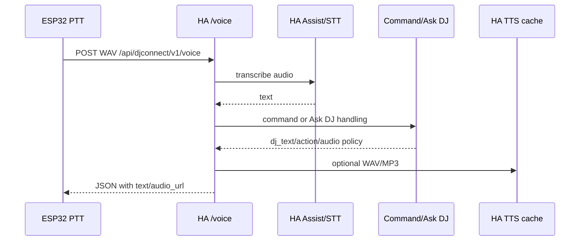

## HA-native conversation implementation — 22 November 2026

## 2026-11-23 shared HA and browser participation candidate

The selected continuation of Core #1532 stage3 is implemented locally on `codex/ha-native-shared-participation-20261123`, based on `bbf56161c4b920ce43f701d3e951e721bba9d6df`. The same Core application service now admits temporary shared-room and browser guests, with host policy, exact-recording proposals, once-only queue dispatch/readback and eligible shared Moment focus/return. The actual paired host and the separate HA OptionsFlow administrator role remain distinct from guest and display principals. No personal Profile history, Music DNA, owner image/audio grants, private transcript or unrestricted controls are granted to a room participant. Core owns the maintained shared renderer and guest page; no duplicate Apple conversation engine or central API/firmware change is introduced.

This is a source candidate, not a protected merge, internal publication, installed capability or physical speech/screen acceptance. Existing broader WEB/Apple/receiver distribution and hardware/editorial acceptance remain open. The previous sections retain the personal-stage scope; the versioned shared contract and limits are in [VIBECAST_GUEST_PARTICIPATION_V1.md](VIBECAST_GUEST_PARTICIPATION_V1.md).

Owner #1532 now selects the native HA adapter to the same Core Ask DJ service.
See [canonical design](HA_NATIVE_VOICE_DJCONNECT_CORE_V1.md). Personal endpoints require explicit installation
consent and separate HA/agent/thread/Profile/Session identity. The ordinary
lifecycle and exact existing Voor jou offer are reused; Apple keeps the same
completion/privacy/audio rules and Watch gains no start/card. Reactive HA
conversation is selected; autonomous room routing and shared guest/request/
display authority remain separately qualified. Local implementation and actual
isolated HA software evidence do not establish merge, installation, provider
quality or physical satellite/audio/display acceptance.

# Voice Transport

## ESP32 PTT

`CONFIRMED_CODE` ESP32 records WAV through `VoiceRecorder` and uploads to HA
`POST /api/djconnect/v1/voice` using `Content-Type: audio/wav`,
`Authorization: Bearer <device_token>` and `X-DJConnect-Device-ID`.

`CONFIRMED_CODE` HA limits WAV size, stores a debug last-voice WAV in runtime
debug state, transcribes through Home Assistant Assist/STT helpers and then
runs the recognized text through command playback logic for ESP audio requests.

## App Ask DJ Voice

`CONFIRMED_CODE` HA treats audio uploads from Ask DJ voice-capable app client
types as Ask DJ input after STT. Response includes `transcript` and
`recognized_text`, plus Ask DJ result fields and optional audio.

Native app input is currently a bounded complete WAV upload. Home Assistant's
selected Assist Pipeline remains canonical STT authority; no DJConnect native
WebSocket streaming, partial-transcript or on-device-STT contract is current.

Application WAV requests bind the actual paired Profile before reading or
transcribing the body. The same synchronous owner fence runs after input-read,
after STT, and after the common Ask DJ service before projecting a private
response. A Profile/token/configuration withdrawal returns a typed error without
the prior transcript, generated answer or audio. App voice responses are
`no-store`; STT-provider failure remains422 and creates no conversation turn.
General and Session voice share the same service and optional context contract
as [text dialogue](../product/ASK_DJ_CONTEXTUAL_DIALOGUE_CONTRACT_V1.md). No new
STT provider, agent setting, streaming transport or recording archive is added.

## Text/JSON Voice Route

`CONFIRMED_CODE` Non-audio JSON/text requests to `/voice` are treated as DJ
response tests and do not run playback command parsing.

## DJ Response Audio

`CONFIRMED_CODE` HA generates temporary TTS audio URLs where possible and posts
DJ responses to ESP32 `/api/device/dj_response`. ESP32 can play WAV/MP3 streams
and otherwise displays text.

## Verification Mapping

`VOICE-001..008`, `ESP-*`, `APPLE-*`, `ASKDJ-*`, `PLAYBACK-*`.
